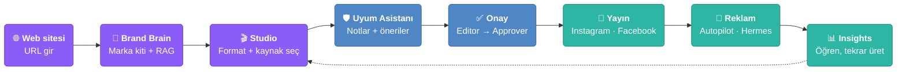
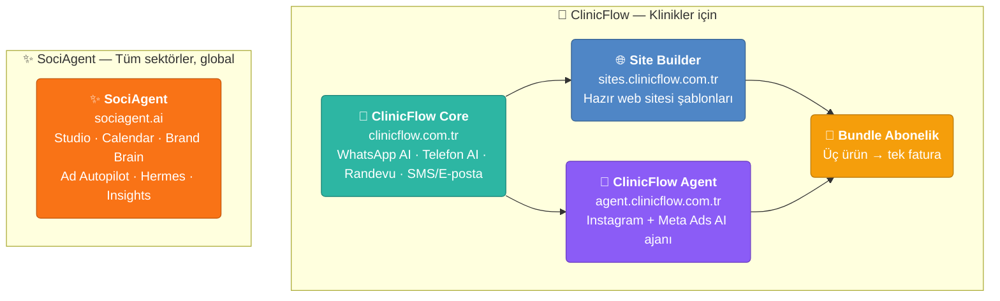

# 🏥 ClinicFlow &nbsp;·&nbsp; ✨ SociAgent

**Özel klinikler için yapay zeka işletim sistemi · Her işletme için yapay zeka sosyal medya ekibi**

 

---

## 👋 Merhaba

Ben **Kadir Aydın** — Endüstri Mühendisi ve yazılım geliştirici. Kurumsal BT/altyapı tarafında çalışırken iki ayrı ürün geliştiriyorum:

- **ClinicFlow** — psikolog, diyetisyen, estetisyen ve diğer özel klinikler için randevudan iletişime, web sitesinden sosyal medyaya kadar operasyonu otomatikleştiren SaaS ailesi.
- **SociAgent** — klinik veya sektör ayrımı olmadan, tüm KOBİ'ler, ajanslar ve içerik üreticileri için global bir yapay zeka sosyal medya ekibi.

İkisi de multi-tenant mimariyle çalışır, ayrı ürünlerdir.

---

## 🚀 Öne Çıkan Proje

### ✨ SociAgent
**Markanı tanır. Ne üreteceğini sen seçersin. Üretir, planlar, yayınlar, reklamı yönetir.** 
Son karar ve sorumluluk her zaman kullanıcıdadır.

SociAgent; planlayıcı + tasarım aracı + video kurgu + reklam yönetimini tek abonelikte birleştiren, **global** bir AI sosyal medya platformudur. Arayüz çok dillidir, içerik her dilde üretilebilir (RTL dahil), kullanıcı başına ücret yoktur.

| | |
|---|---|
| 🧠 **Brand Brain** | Web sitesi URL'sinden logo, renk, font ve marka tonunu otomatik çıkarır; dokümanlarla RAG tabanlı marka hafızası kurar |
| 🎬 **Studio** | Fotoğraf · Carousel · Reels · Story — format ve kaynağı (AI üretsin / kendi medyam / karışık) kullanıcı seçer |
| 📅 **Calendar** | Saat dilimi duyarlı, sürükle-bırak içerik takvimi; en iyi saat önerisi |
| ✅ **Onay Akışı** | Editor → Approver; ajanslar için hesapsız müşteri onay linki |
| 📣 **Reklam Yönetimi** | Meta Ads sihirbazı, özel reklam kategorileri desteği, organik içeriği reklama çevirme (Boost) |
| ⚙️ **Ad Autopilot** | Kural tabanlı (IF-THEN) reklam yönetimi — n8n + Claude Haiku |
| 🤖 **Hermes (Ultra AI)** | Doğal dil komutuyla çalışan canlı reklam ajanı — Nous Hermes Agent + Claude Sonnet |
| 📊 **Insights** | Organik + reklam + dönüşüm performansı, paylaşılabilir raporlar |
| 🛡️ **Compliance Assistant** | Sektör ve ülke kurallarına göre uyarır, yayını engellemez; tüm onaylar kayıt altındadır |
| 🏢 **Workspaces & Roller** | Marka/müşteri bazlı çalışma alanları, ekip rolleri, ajans desteği |
| 📱 **Mobil Uygulama** | iOS + Android — çek, üret, onayla, planla |

**Kanallar:** Instagram + Facebook Sayfası ile başlar; TikTok, LinkedIn, YouTube Shorts, Pinterest, X, Threads sonraki aşamada.

### ⚡ Nasıl Çalışır?

### 🧱 SociAgent Teknolojisi

Paylaşımlı şema + PostgreSQL Row-Level Security · deterministik video render motoru (Playwright + FFmpeg) · AB AI Act md. 50 uyumlu içerik işaretleme (C2PA / IPTC) · Paddle ile global faturalama

---

## 🧩 ClinicFlow Ürün Ailesi

### 🏥 ClinicFlow — Core &nbsp;  &nbsp; `clinicflow.com.tr`

> Kliniğinizin yapay zeka destekli iletişim ve randevu merkezi. Hastalarınızla 7/24 konuşur, randevu defterinizi otonom yönetir, hatırlatmaları kendisi gönderir.

| | |
|---|---|
| 💬 **WhatsApp AI** | Hasta sorularını yanıtlar, randevu oluşturur, takip eder |
| 📞 **Telefon AI** | Sesli yapay zeka ile çağrı karşılama ve yönlendirme |
| 📅 **Akıllı Randevu** | Otonom randevu defteri, çakışma kontrolü, takvim senkronizasyonu |
| 📨 **SMS / E-posta Otomasyonu** | Otomatik hatırlatma, onay ve geri kazanım akışları |

✅ Meta onaylı <b>Tech Provider</b> — WhatsApp AI, resmi <b>WhatsApp Business API</b> üzerinde çalışır.

 

### 🌐 ClinicFlow Site Builder &nbsp; `sites.clinicflow.com.tr`

> Kliniğinize dakikalar içinde profesyonel bir web sitesi. Hazır şablonlar, kod bilgisi gerektirmez.

| | |
|---|---|
| 🎨 **Hazır Şablonlar** | Klinik branşına özel, mobil uyumlu tasarımlar |
| ⚡ **Dakikalar İçinde Yayında** | Kur, içeriğini gir, yayına al |
| 🔧 **Teknik Bilgi Gerekmez** | Sürükle-bırak kolaylığı, bakım derdi yok |

 

### 🤖 ClinicFlow Agent &nbsp;  &nbsp; `agent.clinicflow.com.tr`

> Kliniğinizin yapay zeka sosyal medya ve reklam yöneticisi. Instagram içeriğinizi otonom üretir, Meta reklamlarınızı yönetir, performansınızı izler.

| | |
|---|---|
| 📸 **Otomatik Post Üretimi** | Carousel ve görsel içerikleri uçtan uca otonom üretir |
| ✍️ **İçerik Kişiselleştirme** | Marka tonu ve branşa göre uyarlanmış metin + tasarım |
| 📣 **Reklam Yönetimi** | Meta Ads kampanyalarını kurar ve optimize eder |
| 📊 **Meta Ads Paneli** | Tüm reklam hesabı tek ekranda |
| 📈 **Performans İzleme** | Erişim, etkileşim ve dönüşüm metrikleri |
| 🔗 **Meta Entegrasyonu** | Instagram & Facebook hesaplarıyla doğrudan bağlantı |
| 🏢 **Tenant İzolasyonu** | Her klinik için izole, güvenli veri alanı |
| 💳 **Abonelik Yönetimi** | Otonom faturalama ve plan yönetimi |

---

## 🗺️ Ekosistem

ClinicFlow'un üç ürünü tek altyapıda, tek tek de bundle olarak kullanılır. **SociAgent** ise klinik odaklı olmayan, global ve bağımsız ayrı bir üründür.

### 💎 ClinicFlow Bundle
**Üç ürünü tek pakette, tek faturayla.** &nbsp;Klinik operasyonunun tamamı — iletişim, web ve sosyal medya — tek yerden.

---

## 🛠️ Teknoloji

**Mimari:**
- **ClinicFlow:** Multi-tenant (schema-per-tenant) · EF Core · RabbitMQ tabanlı asenkron iş kuyruğu · wildcard subdomain routing.
- **SociAgent:** Paylaşımlı şema + `organization_id` + PostgreSQL Row-Level Security · pgvector (RAG) · Playwright + FFmpeg render servisi · Expo mobil istemci.
- **Ortak:** Coolify üzerinde CI/CD (GitHub Actions) · Cloudflare DNS.

---

## 📊 GitHub

---

## 🤝 İletişim

 

💚 Kliniğinizi yapay zekayla büyütün — <a href="https://clinicflow.com.tr">clinicflow.com.tr</a> &nbsp;·&nbsp; ✨ Markanızın sosyal medya ekibi — <a href="https://sociagent.ai">sociagent.ai</a>

